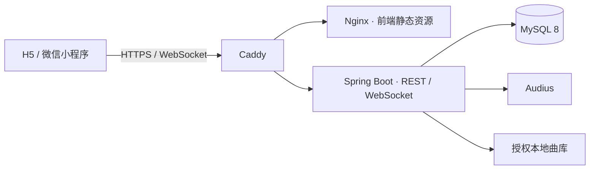

# 同频 SoundZone

> 以“正在做的事”为入口，和同一场景里的人实时听同一首歌。

[在线体验](https://soundzones.cn) · [产品设计](docs/01-product-design.md) · [实施说明](docs/06-implementation.md) · [部署指南](deploy/README.md)

SoundZone 是一个场景化实时共听社区。用户可以围绕自习、跑步、旅行、深夜等场景创建“域（Zone）”，邀请其他人进入同一条播放流，按顺序点歌，并通过图片动态、轻互动和私信认识审美相近的人。

它不是传统歌单工具：歌单记录“我喜欢什么”，SoundZone 更关心“我们此刻正在一起做什么”。

## 在线体验

- 正式地址：[https://soundzones.cn](https://soundzones.cn)
- 无账号也可以通过游客会话快速体验；游客后续可注册账号，并保留已有业务数据。
- 首页提供常驻演示域，方便直接体验同步播放、点歌、动态与互动流程。
- 浏览器通常要求用户先进行一次点击，才允许网页开始播放音频。

当前公开版本为移动端优先的 H5 应用。项目同时保留微信小程序构建能力，但“构建成功”不等于已经完成小程序发布、平台审核和真机音频兼容验收。

## 新用户怎么使用

### 1. 先以游客身份进入

打开 [soundzones.cn](https://soundzones.cn) 后，系统会自动创建游客会话，不需要先注册。首页的 **Featured Zone** 是推荐域，继续下滑可进入 **Explore Zones**；可以搜索域名，也可以按自习、运动、旅行等场景筛选。

### 2. 加入一个域并开始共听

点击域卡片，再点击 **Enter Zone**。公开域可直接进入，私密域需要有效邀请。进入后如果浏览器显示音频解锁提示，点击一次即可开始播放。

- 域内所有人跟随同一个服务端播放进度，不能各自切歌。
- **Up Next** 展示接下来按 FIFO 顺序播放的歌曲。
- 点击右上角悬挂播放按钮，可回到其他页面继续收听；点击左上角返回则退出当前域。
- 点击正在播放区域的爱心可收藏歌曲；点击上传者可以查看对方主页。

### 3. 点歌并分享此刻

点击域内底部的 **Upload Song**，搜索并选择一首可播放歌曲。提交后歌曲进入共享队列；同一用户在同一域点歌后通常需要等待 5 分钟，按钮会显示剩余冷却时间。

点歌成功后可以跳过附图，也可以选择一张图片，把“此刻的场景 + 图片 + 歌曲”发布到 **Moments**。动态会在域内展示约 30 分钟，其他成员可以选择一个 emoji 互动；发布者可在动态详情中撤回自己的内容。

### 4. 创建自己的域

点击底部中间的 **＋**，按向导完成：

1. 输入域名；
2. 选择或上传封面（可跳过，默认使用第一首歌封面）；
3. 选择正在发生的场景；
4. 搜索并按顺序选择恰好 3 首初始歌曲；
5. 按需设置歌曲标签过滤、共享番茄钟和私密访问；
6. 检查摘要后点击 **Create Zone**。

共享番茄钟提供经典 25/5 和深度 40/10 两种节奏。开启“Music by phase”后，还可分别设置专注与休息阶段允许的歌曲标签。

### 5. 保存身份并认识同频的人

进入底部 **Me** 页面可以修改头像、ID 和背景，查看收听时长、收藏、上传、动态和自己创建的域。游客点击“登录或注册账号”即可注册；当前游客会话中的业务数据会保留到新账号中。

在其他用户主页可以关注对方；已建立关注关系后可发送一对一文字私信。首页右上角的铃铛用于查看站内通知。

## 核心体验

```text
选择正在发生的场景
        ↓
创建或加入一个域
        ↓
所有成员收听同一条播放流
        ↓
按 FIFO 顺序点歌、分享图片与轻互动
        ↓
关注同频的人，沉淀自己的声音档案
```

## 已实现功能

| 模块 | 当前能力 |
| --- | --- |
| 域（Zone） | 浏览公开活跃域；创建、编辑、加入和退出域；公开／私密设置；域封面、场景和标签过滤；邀请与举报 |
| 同步播放 | 服务端权威播放时钟；域内成员同步收听；FIFO 点歌队列；单用户单域冷却；WebSocket 实时更新与轮询兜底 |
| 共享番茄钟 | 域级统一计时；经典 25/5 与深度 40/10 两种预设；可按专注／休息阶段预存不同标签的歌曲 |
| 音乐与互动 | Audius 官方开放曲库与自有授权曲库；搜索、点歌、点赞、收藏；无可播放音源时明确提示 |
| 图片动态 | 点歌后可选附图；域内半小时动态流；单选 emoji 互动；本人可撤回；图片访问进行成员与身份校验 |
| 账号与主页 | 游客会话；注册、登录和退出；游客原地升级；头像、封面与个人资料；关注关系、上传、收藏和建域记录 |
| 社交与通知 | 关注用户间的一对一文字私信；消息持久化；站内通知、未读数与已读状态 |
| 声音档案 | 收听时长汇总，以及个人收藏、上传、动态和创建域等内容入口 |
| 演示与运营 | 4 个常驻演示域；最小必要业务指标；带授权记录的数据导出与撤回机制 |

项目刻意不做评论区、群聊、积分等级和“歌品值”，优先保持共听过程轻量、低压力。

## 技术架构



| 层级 | 技术 |
| --- | --- |
| 前端 | uni-app、Vue 3、Vite 5、SCSS |
| 后端 | Java 17、Spring Boot 3.3、Spring Data JPA、WebSocket |
| 数据 | MySQL 8；H2 仅用于自动化测试 |
| 媒体 | Audius 官方开放接口、可核验授权的本地音频与封面 |
| 部署 | Docker Compose、Caddy、Nginx、腾讯云轻量应用服务器 |
| 持续交付 | GitHub Actions 自动执行后端测试、H5 构建和生产发布 |

## 项目结构

```text
sound-zone/
├── app/                        # uni-app 前端（H5 / 微信小程序）
├── server/                     # Spring Boot 后端
│   └── sql/                    # 完整表结构与增量迁移
├── deploy/                     # Caddy、迁移与发布脚本
├── docs/                       # 产品、流程、路线图与实施文档
├── docker-compose.yml          # 本地 MySQL
├── docker-compose.prod.yml     # 生产环境服务编排
└── .github/workflows/          # 测试与自动部署
```

## 本地开发

### 环境要求

- JDK 17
- Maven 3.9+
- Node.js 20 与 npm
- Docker 与 Docker Compose（用于本地 MySQL 8）

### 1. 启动并初始化数据库

```bash
docker compose up -d mysql
docker compose exec -T mysql \
  mysql -usoundzone -psoundzone123 soundzone < server/sql/schema.sql
```

以上账号和密码只用于本地开发。已有数据库不要重复导入完整表结构，请先备份，再按照[迁移说明](server/sql/migrations/README.md)执行增量脚本。

### 2. 启动后端

```bash
cd server
mvn spring-boot:run
```

后端默认运行在 `http://localhost:8080/api`。健康检查地址为 `http://localhost:8080/api/actuator/health`。

### 3. 启动前端

另开一个终端：

```bash
cd app
npm install
npm run dev:h5
```

开发模式默认请求当前页面主机的 `8080/api`。如需连接其他后端，可在 `app/.env.local` 中设置：

```dotenv
VITE_API_BASE=http://localhost:8080/api
VITE_H5_SHARE_BASE=http://localhost:5173/
```

更多配置、曲库接入和跨设备调试方式见[前端说明](app/README.md)与[后端说明](server/README.md)。

## 测试与构建

后端行为测试使用独立 H2 测试库：

```bash
cd server
mvn test
```

构建 H5：

```bash
cd app
npm ci
npm run build:h5
```

构建微信小程序代码：

```bash
cd app
npm ci
npm run build:mp-weixin
```

小程序上线前仍需配置 AppID、合法请求域名和隐私声明，并在微信开发者工具及真机上完成登录、上传、WebSocket 和音频播放验收。

## 生产部署

生产环境使用 Caddy 统一处理 HTTPS、域名与反向代理，Nginx 提供前端静态资源，Spring Boot 提供 API 和 WebSocket，MySQL 保存业务数据。

向 `main` 推送可部署代码后，GitHub Actions 会依次执行：

1. 后端自动化测试；
2. H5 生产构建；
3. 将代码同步到腾讯云；
4. 构建并滚动更新容器；
5. 检查生产健康状态。

发布所需的服务器准备、GitHub Secrets、数据库迁移和回滚约定见[部署指南](deploy/README.md)。生产环境变量、数据库、上传图片和授权媒体文件均不会提交到 Git。

## 音乐来源与版权边界

当前 Demo 使用 Audius 官方开放曲库和带可核验授权引用的自有小曲库。项目通过 `MusicProvider` 边界隔离外部曲库；在取得书面接口与版权授权前，不调用非官方 QQ 音乐接口，也不把第三方账号登录等同于曲库授权。

公开运营前仍需根据目标地区、使用方式和具体曲目，逐项复核在线播放、同步播放、缓存、展示和用户上传相关授权。

## 文档导航

- [01 · 产品设计](docs/01-product-design.md)：定位、用户痛点、核心概念与竞品差异
- [02 · 核心工作逻辑](docs/02-core-workflow.md)：域的生命周期、同步播放、FIFO、准入与轻互动
- [03 · 数据飞轮](docs/03-data-flywheel.md)：场景—图片—歌曲三元组与长期模型方向
- [04 · MVP 与路线图](docs/04-mvp-roadmap.md)：MVP 范围、验证指标、阶段规划与风险
- [05 · 开发计划](docs/05-dev-plan.md)：模块拆分、里程碑和交付顺序
- [06 · 实施说明](docs/06-implementation.md)：当前接口、数据结构、业务规则与验收口径
- [前端开发说明](app/README.md)
- [后端开发说明](server/README.md)
- [生产部署说明](deploy/README.md)

## 路线图

当前重点是验证“场景命名的实时共听”是否成立，并持续完善真实设备体验、内容治理和运营指标。AI DJ、域歌单沉淀、KOL 域主生态、品牌联名域和多模态配乐模型属于后续阶段，不作为当前已上线能力展示。
